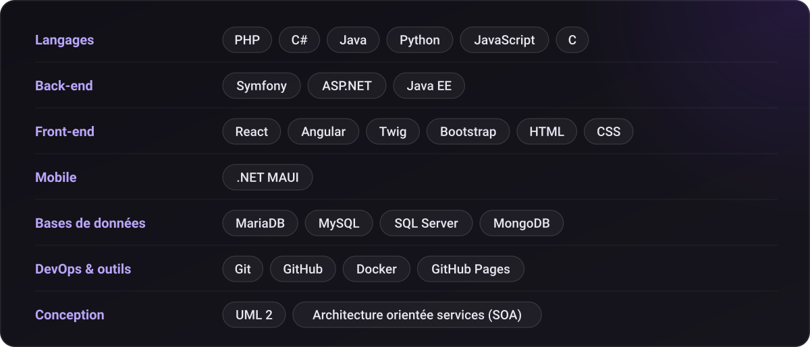
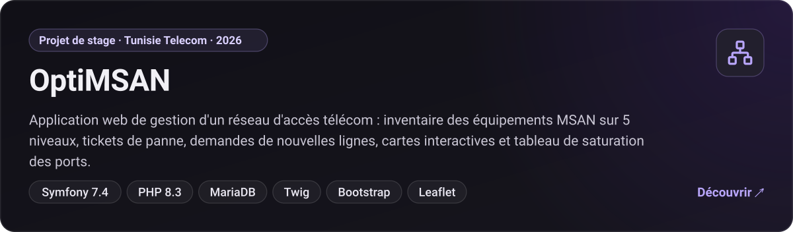
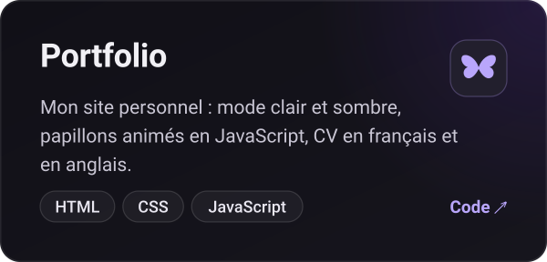
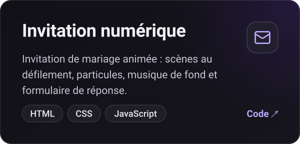

  

  
  
  
  

## À propos

Étudiante en 3e année de **Licence en Développement des Systèmes d'Information** à l'ISET de Mahdia, je conçois des applications web complètes, de la modélisation des données jusqu'à l'interface.

- **Je recherche** un stage PFE de 4 mois pour le second semestre 2026-2027
- **Dernier projet :** [OptiMSAN](https://inesgha.github.io/#projets), une application de gestion d'un réseau d'accès télécom, réalisée en stage chez Tunisie Telecom
- **J'apprends** Git et GitHub (Coursera), les chaînes DevOps et les tests logiciels
- **Je parle** arabe, français et anglais

## Stack technique

## Projets à la une

  
  

## Activité

<picture>
  <source media="(prefers-color-scheme: dark)" srcset="https://raw.githubusercontent.com/inesgha/inesgha/output/github-snake-dark.svg">
  
</picture>

Merci de votre visite ! Tout mon parcours est sur <a href="https://inesgha.github.io">inesgha.github.io</a>

